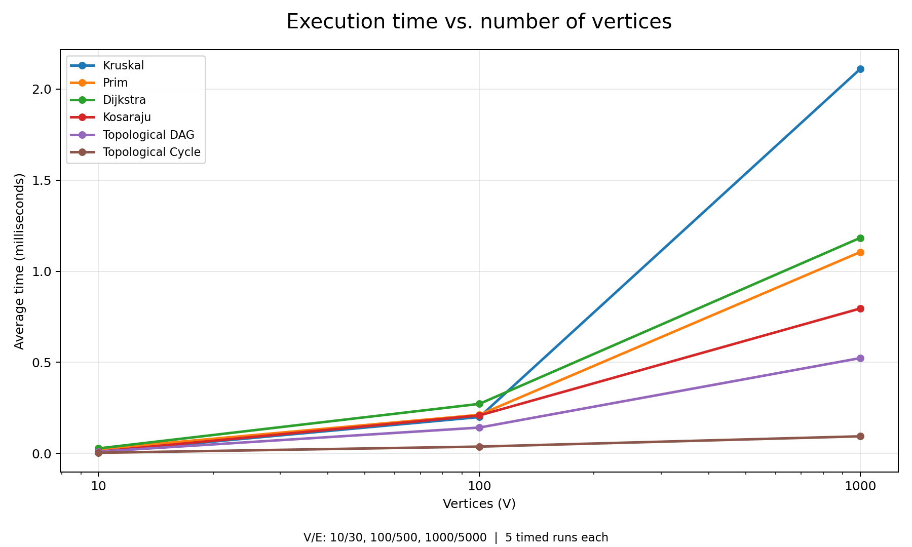
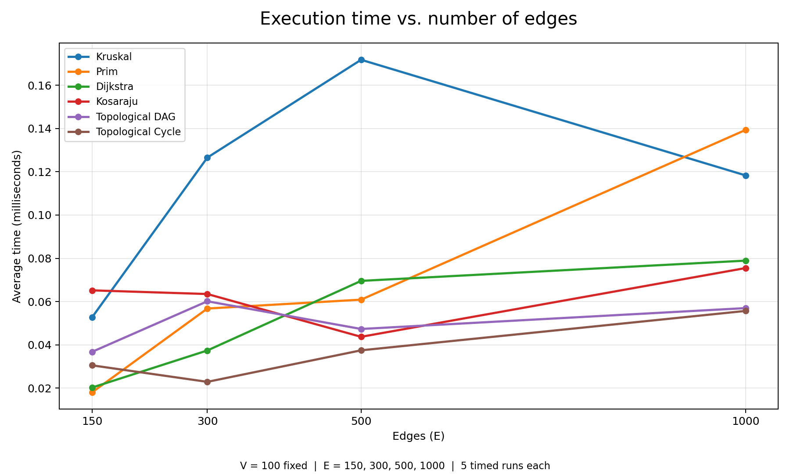

# Assignment 3 — Smart City Infrastructure and Route Planning

## Overview

This Java program models a city as a graph. Vertices represent districts, edges represent roads or connections, and weights represent costs or distances. The program can build a cheap connected road network, check directed connections, and find shortest routes.

The project uses simple Java classes and adjacency lists. No external Java libraries are required.

## Project Structure

```text
assignment-3/
  src/
    graph/
      Edge.java
      Graph.java
      GraphFactory.java
    dsu/
      DSU.java
    mst/
      MST.java
    connectivity/
      Connectivity.java
    shortestpath/
      Dijkstra.java
    Main.java
    Tests.java
  results/
    tables/
      benchmark.csv
      edge_sweep.csv
      tests.txt
    plots/
      time_vs_vertices.png
      time_vs_edges.png
  README.md
  plot_results.py
```

## Implementation

- **src/graph/Graph.java:** Stores vertices, edges, weights, and adjacency lists. Supports both undirected and directed graphs.
- **src/dsu/DSU.java:** Contains `find` and `union` with path compression and union by rank.
- **src/mst/MST.java:** Contains Kruskal and Prim.
- **src/connectivity/Connectivity.java:** Contains topological ordering (Kahn) and SCC (Kosaraju).
- **src/shortestpath/Dijkstra.java:** Contains Dijkstra.
- **src/graph/GraphFactory.java:** Creates reproducible random graphs.
- **src/Tests.java:** Checks important cases and algorithm correctness.
- **src/Main.java:** Shows sample routes, runs tests, measures performance, and saves CSV files.
- **plot_results.py:** Creates the two PNG plots from saved CSV results (optional; plots are already included).

**Kruskal** sorts edges by weight and joins different sets using DSU. **Prim** starts from one district and picks the cheapest available road using a priority queue. Both produce the same minimum total cost on connected, undirected graphs.

**Topological ordering** processes vertices with zero incoming edges; it reports a cycle when it cannot visit all vertices. **Kosaraju** runs DFS, reverses the directed graph, then runs DFS again to find strongly connected components. **Dijkstra** uses a priority queue to find minimum distances from district 0 and stores previous vertices to reconstruct each path. Unreachable vertices have distance `Integer.MAX_VALUE` and an empty path.

## Complexity Analysis

Here `V` is the number of vertices and `E` is the number of edges. The graph uses an adjacency list and the priority queues are binary heaps.

| Algorithm | Time complexity | Total space complexity | Main reason |
|---|---|---|---|
| DSU `find` / `union` | `O(α(V))` amortized per operation | `O(V)` | Path compression and union by rank |
| Kruskal | `O(E log E + E α(V))` | `O(V + E)` | Sorting edges and using DSU |
| Prim | `O(E log E)` | `O(V + E)` | Priority queue and adjacency list |
| Kosaraju SCC | `O(V + E)` | `O(V + E)` | Two DFS passes and reverse graph |
| Topological ordering | `O(V + E)` | `O(V + E)` | Indegrees, queue, and edge visits |
| Dijkstra | `O((V + E) log V)` | `O(V + E)` | Priority queue on a non-negative weighted graph |

The space values include the stored graph. DSU path compression makes later `find` calls faster by shortening parent paths. Union by rank prevents tall trees. Together they make DSU operations almost constant time in practice.

For Kruskal, sorting can dominate when there are many edges. For Prim and Dijkstra, adding more edges can mean more priority-queue work. Kosaraju and topological ordering process vertices and edges linearly.

Dijkstra is unsuitable for negative edge weights: a cheaper path may appear after a vertex was considered, so its usual greedy correctness guarantee no longer applies. This implementation rejects any negative-weight edge.

## Experimental Setup

The main experiments use three graph sizes:

| Graph | Vertices | Edges |
|---|---:|---:|
| Small | 10 | 30 |
| Medium | 100 | 500 |
| Large | 1000 | 5000 |

For each size the program creates three graph types:

1. **Undirected, connected:** Adds a chain of `V - 1` roads first, then adds random unique roads until `E` edges. Used for Kruskal, Prim, and Dijkstra.
2. **Directed acyclic (DAG):** Adds only edges from lower-numbered vertices to higher-numbered vertices. This cannot create a directed cycle. Used for topological ordering.
3. **Directed cyclic:** Adds `0 -> 1 -> 2 -> 0` first, then adds random unique directed edges. The graph definitely contains a cycle. Used for topological ordering and Kosaraju SCC.

All random weights are integers from **1 to 20**, and duplicate random edges are skipped. Graphs are reproducible using the fixed seed rule `2026 + V * 31 + E * 17 + type`, where the type is 1, 2, or 3.

For each algorithm and graph size:

- Run **3 warm-up rounds**, then **5 measured rounds** on the same graph.
- Use `System.nanoTime()` for each measured run.
- Convert nanoseconds to milliseconds and report the average of the 5 runs.
- Count relevant operations. Kruskal includes sorting comparisons, checked edges, and DSU calls. Prim and Dijkstra include queue comparisons, checked edges, and queue removals. Topological ordering counts indegree/edge processing and vertex removals. Kosaraju counts visited vertices and processed edges across its passes.
- Run a separate edge experiment with **V = 100** and **E = 150, 300, 500, 1000**. This keeps the number of vertices fixed for the second plot.

The actual CSV measurements were made by running the program. Results depend on hardware, JVM warm-up, and other running programs, especially for very small graphs.

## Results

Average time is shown in milliseconds. The operation counts are the code's explicitly counted operations, **not CPU instructions**.

| V | E | Algorithm | Average time (ms) | Operations |
|---:|---:|---|---:|---:|
| 10 | 30 | Kruskal | 0.0070 | 175 |
| 10 | 30 | Prim | 0.0238 | 292 |
| 10 | 30 | Dijkstra | 0.0273 | 130 |
| 10 | 30 | Kosaraju | 0.0097 | 110 |
| 10 | 30 | Topological DAG | 0.0097 | 70 |
| 10 | 30 | Topological Cycle | 0.0032 | 30 |
| 100 | 500 | Kruskal | 0.1995 | 5002 |
| 100 | 500 | Prim | 0.2118 | 9011 |
| 100 | 500 | Dijkstra | 0.2718 | 3134 |
| 100 | 500 | Kosaraju | 0.2084 | 1700 |
| 100 | 500 | Topological DAG | 0.1417 | 1100 |
| 100 | 500 | Topological Cycle | 0.0372 | 507 |
| 1000 | 5000 | Kruskal | 2.1106 | 56201 |
| 1000 | 5000 | Prim | 1.1053 | 122043 |
| 1000 | 5000 | Dijkstra | 1.1834 | 43936 |
| 1000 | 5000 | Kosaraju | 0.7955 | 17000 |
| 1000 | 5000 | Topological DAG | 0.5232 | 11000 |
| 1000 | 5000 | Topological Cycle | 0.0937 | 5037 |


Raw table: [results/tables/benchmark.csv](results/tables/benchmark.csv).

### Execution time vs. vertices



### Execution time vs. edges

The following table shows average milliseconds with **100 vertices**. Full operation counts and cycle results are in the CSV.

| E (V=100) | Kruskal | Prim | Dijkstra | Kosaraju | Topological DAG |
|---:|---:|---:|---:|---:|---:|
| 150 | 0.0527 | 0.0180 | 0.0202 | 0.0652 | 0.0367 |
| 300 | 0.1266 | 0.0568 | 0.0374 | 0.0635 | 0.0601 |
| 500 | 0.1718 | 0.0609 | 0.0696 | 0.0437 | 0.0473 |
| 1000 | 0.1183 | 0.1393 | 0.0789 | 0.0755 | 0.0570 |




Raw table: [results/tables/edge_sweep.csv](results/tables/edge_sweep.csv).

## Comparison and Discussion

- **MST correctness:** Kruskal and Prim returned identical minimum spanning tree weights for all three connected graph sizes. In the 10-vertex example, both returned a total weight of **45**.
- **Kruskal vs. Prim:** Both have good asymptotic complexity but perform different operations. Kruskal sorts all edges and uses DSU; Prim adds candidates to a priority queue. Their measured times may change relative to each other across graphs and JVM runs.
- **DSU performance:** Path compression reduces future searches, and union by rank helps keep DSU trees short. This avoids expensive repeated scans when Kruskal decides whether an edge connects two components.
- **SCC growth:** Kosaraju visits vertices and edges a small number of times. Its operation count increases linearly with the size of the graph; the main table shows **110, 1700, and 17000** counted operations.
- **DAG vs. cycle:** The DAG always returned a complete valid ordering. The cyclic graph always reported that topological ordering is impossible. For a cyclic graph, Kahn's algorithm may stop early when its queue is empty; a short runtime does not mean that cycles make the general problem easier.
- **Dijkstra growth:** More vertices and roads require more edge checks and priority queue work. The shortest paths can be reconstructed from the `previous` array.
- **Measured time vs. theory:** The general increase in work agrees with the complexity table. Exact times are not perfectly smooth because the measurements are very short and affected by JVM optimizations and system noise. Also, the main vertex experiment increases both `V` and `E`; the separate edge experiment isolates increasing `E` while keeping `V` fixed.

## Testing

`Tests.java` runs **25 checks**, and all 25 passed in the supplied run. These include:

- A single-vertex graph.
- A small graph with a known MST total cost of 6.
- A known shortest path from 0 to 3 with distance 6.
- A disconnected graph and an unreachable vertex.
- Equal/duplicate weights and multiple valid MSTs.
- Correct DAG topological ordering and detection of directed cycles.
- One large SCC and a graph with three SCCs.
- A check that every vertex appears in exactly one SCC.
- Rejection of negative Dijkstra weights.
- Connected MST comparisons, valid DAG ordering, cycle detection, and SCC partition checks for 10, 100, and 1000 vertices.

Test log: [results/tables/tests.txt](results/tables/tests.txt).

## How to Run

**IntelliJ IDEA:** Open the `assignment-3` folder, set a JDK (Java 17 or newer), mark `src` as Sources Root if needed, and run `Main.java`. To run only tests, run `Tests.java`.

**Terminal (Windows PowerShell):** From inside the `assignment-3` folder, run:

```powershell
javac -d out -sourcepath src src\Main.java src\Tests.java
java -cp out Main
```

For tests only:

```powershell
java -cp out Tests
```

Running `Main` prints the example, checks the algorithms, and regenerates both CSV result files. To regenerate the included plots from the new CSV measurements, install Python with matplotlib and run:

```bash
python -m pip install matplotlib
python plot_results.py
```

The PNG plots are already in the repository, so Python is **not needed** to run the Java project.

## Conclusion

Kruskal and Prim both find a low-cost road network. Kruskal is easy to use when we have an edge list; Prim is useful when we grow a network from a starting district. DSU helps Kruskal quickly check whether districts are already connected. Topological sorting handles directed dependencies without cycles. Kosaraju finds groups of mutually reachable districts. Dijkstra finds shortest routes when road weights are not negative.

The tests show the algorithms working on small, disconnected, cyclic, and randomly generated graphs. The experiments show how running time and counted work increase when the city network becomes larger.
